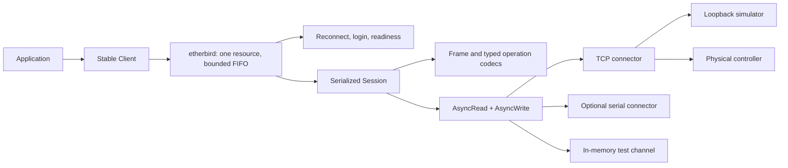

# Architecture

Protocol encoding and model dispatch contain no socket or supervision logic.
The Connector boundary supplies fresh channels. Session owns one stream generation
and response correlation; Client owns an etherbird pool with one exclusive resource.

Built-in calls share an internal PreparedOperation containing the opcode, owned
payload, optional expected reply size and a generic decoder. Client validates it
before queue admission; Session validates it at execution; ManagedContext uses
the same preparation inside an already-exclusive workflow. Decoding always runs
before exchange completion. Public custom Operation codecs use this path too.
The internal representation adds no boxed decoder or public API requirement.

Protocol owns ordinary-unicast validation and allocation-free ParameterBudget
calculations. Encoding, profile checks and schema batching use those calculations.
Catalog table facts live in catalog/entries.rs; catalog.rs owns applicability and
location lookup. Wire fixtures remain independent of production codecs.

An internal PayloadReader performs checked slicing, value decoding and trailing
data checks for both arbitrary and contiguous parameter replies. Each operation
still supplies its own echo and truncation error messages.

One outstanding operation per stream is intentional: ordinary ROC Plus frames
provide no request identifier for pipelining. Source/destination and opcode are
validated before accepting a response. An interrupted exchange retires the stream;
a valid opcode-255 rejection preserves it.

etherbird's optional RetireOnDrop guard borrows the stream slot until the exchange completes. Dropping
an incomplete future clears that slot and signals loss. etherbird's watcher observes
the signal even with periodic heartbeats disabled. This prevents stale reply reuse.

etherbird's operation failure policy retains valid device/local errors and returns
them unchanged to the application. This distinction prevents a healthy protocol
rejection from triggering unnecessary reconnect/login. Decoder/transport failures
request recovery.

etherbird's BoundedFifoQueue bounds waiting work; execute_with_timeout and
connected_with_timeout enforce the call deadline with shutdown precedence and
no replay. The call deadline includes admission and lifecycle readiness. The wire deadline
starts after the stream mutex is acquired, so contention with a heartbeat is not
misclassified as peer silence. Configured creation/setup deadlines bound each
recovery attempt. Explicit rejected/unsupported authentication latches in
etherbird, publishes Failed, fails waiting calls promptly and suspends further attempts.
Client preserves its public authentication error shape. Await stop and create a new
client to change credentials; transport setup failures remain recoverable.

Awaited stop releases framework resource caches and pool entries. Session teardown
still explicitly closes the stream and destroys generation state. External handles,
user captures and abandoned timed-out hooks can retain resources after stop;
object destruction alone does not guarantee secret erasure.

The simulator's pure Model dispatch runs behind the same framing/stream boundary.
Unit tests include published CRC examples and literal typed payloads. An independent
peer integration fixture neither encodes nor decodes through rocsteady, limiting
shared-client/simulator false positives.

The event receiver is stable across generations and bounded. SRBX signals are
processed during active exchanges/heartbeats. No automatic alarm acknowledgement
is emitted because it requires knowledge of the alarm log entries actually consumed.

The first EXT-1/4/5 slice now uses the [managed extension contracts](MANAGED_EXTENSIONS.md).
A Session ownership mutex spans entire setup/workflow scopes and is shared by
ordinary requests and heartbeats; the inner stream guard still retires incomplete
exchanges. Cancelled scopes between exchanges signal retirement before releasing
ownership. Setup state is installed once per generation and accessed by borrowing
the scoped context. Registration is immutable; setup is repeated on replacement.
